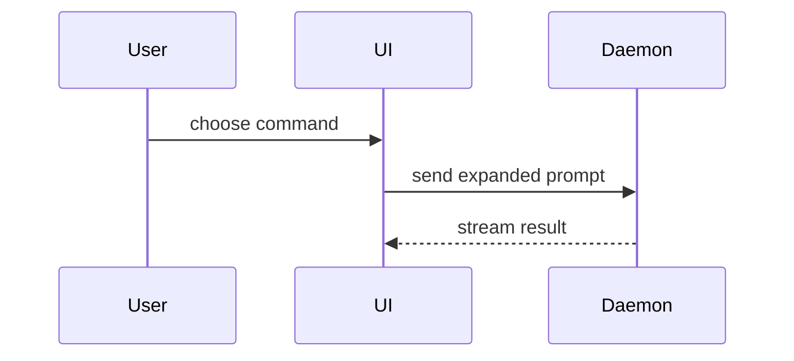

Help the user understand the current topic of conversation visually. Skip the preamble and keep prose brief. Pick the smallest view that makes the key point clear.

- Show logic or an algorithm as pseudocode:

```text
on(save)
  if content is unchanged
    return cached result
  write new content
  return fresh result
```

- Show runtime control flow as a call tree:

```text
submitForm
  createSession
    persistPrompt
    launchAgent
  navigateToSession
```

- Show UI structure as a component tree, including state and module boundaries that matter:

```tsx
<SessionPage> (apps/example/src/routes/session.tsx)
  useSessionEvents()
  <SessionToolbar>
    <RunSkillButton> (packages/ui)
```

- Show file responsibility or a broad refactor as a shallow file tree:

```text
src/
├── commands/       # parses user actions
├── sessions/       # owns session state
└── transport/      # sends API requests
```

- Show component interaction, control flow, or data flow with Mermaid:



- Use `diff` when the point is what changes and the surrounding shape already exists. Match the diff shape to the topic.

For a component change:

```diff
 <SessionPage>
   useSessionEvents()
   <SessionToolbar>
+    <RunSkillButton />
   <SessionTimeline>
+    <SkillResultCard />
```

For a file-layout change:

```diff
 src/
 ├── commands/
+│   └── show-me.ts       # expands the slash command
 ├── sessions/
-└── transport.ts
+└── transport/
+    ├── client.ts
+    └── stream.ts
```

For a call-tree or call-stack change:

```diff
 submitForm
   createSession
     persistPrompt
+    expandSkillMention
     launchAgent
-  navigateToSession
+  navigateToSession
+    subscribeToEvents
```

For a state or control-flow change:

```diff
 on(save)
-  write content
+  if content is unchanged
+    return cached result
+  write new content
+  invalidate cache
```

- Show the whole block when most of it is new, when omitted context would hide ownership or order, or when the user needs a copyable target shape:

```ts
function expandSkill(command: string): string {
  const skillName = command.slice(1)
  return `use the ${skillName} skill`
}
```

## Paired visual comparison

When the user asks for Visual Artifact and HTML versions of the same visual request, coordinate 2 separate subagents:

```text
show-me
├── Visual Artifact subagent
└── HTML subagent
```

The `show-me` parent coordinates the work and compares the results. It does not build or edit either version.

1. Give both subagents the same visual request, source context, and acceptance criteria.
2. Make each subagent responsible for one version and one distinct file under the current project's `ai-artifacts/` directory.
3. Ask the Visual Artifact subagent to follow the Visual Artifact workflow below and build the result from native artifact nodes.
4. Ask the HTML subagent to create a standalone HTML version.
5. Keep one writer active at a time when both subagents use the same checkout.
6. Inspect both outputs after they finish. Compare clarity, fidelity to the request, interaction, portability, and maintenance cost.
7. Report both file paths, the Visual Artifact URL when available, and a concise recommendation.

Do not collapse the work into one subagent. Do not let one version become source material for the other. The comparison requires 2 independent interpretations of the same request.

## Visual artifacts

For a visual UI, layout, state comparison, or concept too dense for Mermaid, use the Visual Artifact workflow. Build the result from native artifact nodes. Do not embed HTML in the visual artifact.
1. Before inspecting sources or composing the artifact, choose a visual direction with 2 to 4 options.
2. Store the constrained JSON source spec at `ai-artifacts/show-me/<slug>.json`, relative to the current project's canonical root. Create `ai-artifacts/show-me/` if it does not exist.
3. Run `visual-artifact contract`. Use only supported node types, props, and resource limits, subject to the no-embedded-markup restriction above.
4. In Pi, call `create_visual_artifact` with the selected direction instruction unchanged. Report the returned URL. In a runtime without that workflow, use Mermaid or a text diagram instead.

### Guidance

Place each visual next to the short text it supports. Keep only the calls, files, props, states, and boundaries needed to answer the user's current question or resolve the current decision.
