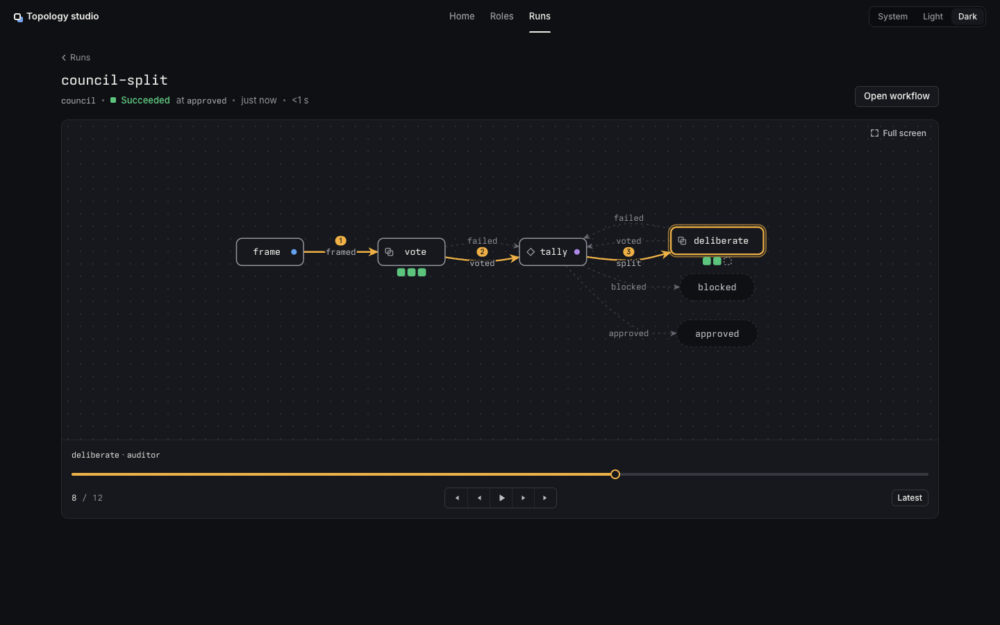
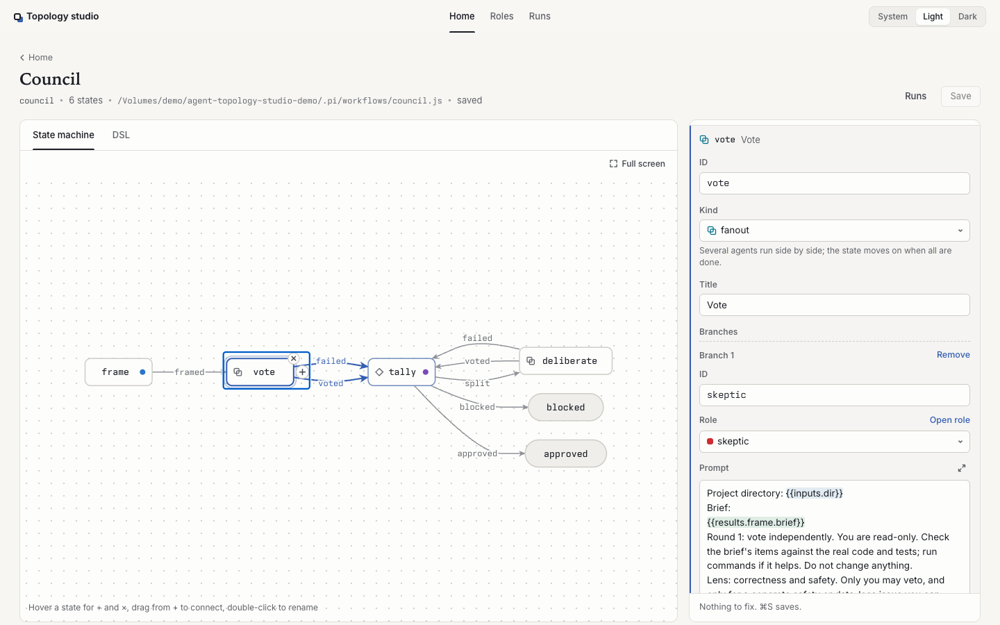

# Agent topology studio

A local editor and run viewer for Pi subagent workflows.

A workflow is a state machine. The studio compiles it to a runnable JavaScript file and reads it back without executing code. No LLM translates your workflows. Each run leaves a journal, and the studio replays it on the graph.





## Requirements

- Node 22.12 or newer. Working on the source needs Node 22.18 or newer.
- To run workflows: Pi with its subagents extension, which provides `SubagentWorkflow`. Install it with `pi install npm:@tintinweb/pi-subagents`.

The studio edits and replays workflows. Pi runs them.

## Try it

```sh
git clone https://github.com/iurysza/agent-topology-studio
cd agent-topology-studio
./reset-playground.sh
npm start -- --project playground
```

The first run installs dependencies and builds the web app. The server binds to `127.0.0.1` and opens a token-protected URL. `playground/` is an untracked sample project; `./reset-playground.sh` restores it.

## Use it on your project

A project is any folder with `.pi/workflows/*.js` and `.pi/agents/*.md`.

```sh
npm start -- --project /path/to/your/repo
```

Then:

1. Create a workflow: `node bin/studio.ts new hello --project <dir>`.
2. Create a role for its agents: `node bin/studio.ts role new coder --description "Writes code" --project <dir>`.
3. Edit the workflow in the studio and press Save (⌘S). Problems block saving; warnings do not.
4. Check it: `node bin/studio.ts check hello --project <dir>`.
5. In Pi, ask the agent: "Run the `hello` workflow with SubagentWorkflow, args `{ ... }`."
6. The run appears on the Runs page, where you can replay it step by step.

Agents can edit workflows through the same [CLI](reference/cli.md), without the server.

### From Pi

The package's Pi extension adds `/studio`. It starts or reuses a studio for the current folder and opens it. `/studio stop` stops it, `/studio pick` chooses a project and `/studio all` opens every project that has workflows. The studio keeps running after Pi quits.

## Workflow files

Each `.pi/workflows/<id>.js` holds `meta`, a `const machine` literal and a fixed runner. States are tasks, decisions or fanouts, connected by named events. A task can carry a `gate` shell command that must pass.

Prompts can use placeholders such as `{{inputs.slug}}`, `{{results.qa.report}}` and `{{visit}}`. Gate placeholders are inserted as quoted data. Each state's visit cap defaults to three.

Saving checks the file hash it last loaded and writes atomically. If another editor changed the file, the studio refuses the save and asks you to reload.

See [the workflow API](reference/workflow-api.md) and [the CLI reference](reference/cli.md), including [tokenless mode](reference/cli.md#tokenless-mode-and---public-origin) and [all projects](reference/cli.md#all-projects).

## Develop

Read [AGENTS.md](AGENTS.md), then the [knowledge base](ai-artifacts/_index.md).

```sh
npm run dev -- --project playground
npm test
npm run verify   # lint, typecheck, tests, builds and package checks
```

## License

MIT. See [LICENSE](LICENSE). The package is not published to npm yet.

Bundled dependency and font notices ship in `web/dist/THIRD_PARTY_NOTICES.txt`.

The machine model and UI were inspired by [backnotprop/machine](https://github.com/backnotprop/machine) and the [Interfere](https://interfere.com) design system.
