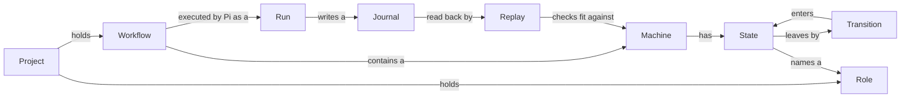

# Topology studio context

Topology studio is a local editor and run viewer for Pi workflows. It edits the state machine inside each workflow file and replays past runs against it. It never runs a workflow itself. These terms give the [architecture](./architecture.md) and the [decisions](./docs/adr/INDEX.md) one shared meaning.

## Model

## Language

### Workflows and machines

**Workflow**:
One `.pi/workflows/<id>.js` file in a project that Pi can run. A workflow the studio writes holds a `meta` export, a `const machine` literal and the runner.
_Avoid_: script, topology, pipeline

**Machine**:
The `const machine` object literal inside a workflow: its `id`, `inputs`, `initial` state and `states`. `extract` reads it from a file and `compile` writes it back (`shared/machine.ts`). The UI calls it "State machine".
_Avoid_: graph, flow, config

**State**:
One named step in a machine. Its kind decides what it does and which keys it may have.
_Avoid_: node, step, phase

**Kind**:
The type of a state: `task`, `decision`, `fanout` or `final`. `validateMachine` in `shared/machine.ts` holds the rules for each kind.
_Avoid_: type, state type

**Transition**:
A move from one state to another, named by an event. The UI says "Transitions". The file format, runner and CLI keep the words `on` and `event`. Both names mean the same thing.
_Avoid_: edge, outcome, "events" in UI copy

**Event**:
The label an agent reports when a state finishes, such as `done` or `failed`. A state's `on` map sends each event to the next state.
_Avoid_: signal, result code

**Gate**:
A shell command on a `task` state or a fanout branch. It must pass before the agent's result counts. A placeholder in a gate becomes shell-quoted data (`shared/gate.ts`).
_Avoid_: check, hook, guard

**Placeholder**:
A `{{path}}` reference in a prompt or gate, such as `{{inputs.dir}}` or `{{results.plan.text}}`. The runner fills it in. It is plain text on disk.
_Avoid_: variable, template tag

**Chip**:
How the editor shows a placeholder: a tinted token in a text field instead of raw `{{...}}` text. Chip text is plain ink. Only the tint shows the chip's kind. Typing `$` opens a picker that inserts one.
_Avoid_: pill, tag, badge

**Ref**:
A path a placeholder may use at a given state: workflow inputs, results of other states, `visit` and `run.history` (`shared/refs.ts`). The picker leaves out the current state's own results.
_Avoid_: binding, reference variable

**Runner**:
The fixed code in `shared/runner.ts` that walks the machine. `compile` appends it to every workflow, so every copy must end with it unchanged.
_Avoid_: engine, interpreter, executor

**Role**:
A Pi agent definition in `.pi/agents/<name>.md` that a task, decision or fanout branch names. Its frontmatter sets the model and tools.
_Avoid_: agent type, persona, worker

### Runs

**Run**:
One execution of a workflow by Pi. The studio reads runs and never starts one.
_Avoid_: execution, job, session

**Journal**:
The `<runId>.workflow.jsonl` file Pi writes for a run. Each line is one agent call. The studio finds journals in the project and in Pi's session task folders.
_Avoid_: log, trace, history file

**Hop**:
One transition a run took, numbered in order: from a state, by an event, to the next state (`Hop` in `web/src/runs.ts`). The graph shows hop numbers on each transition the run used, so a loop shows several numbers on one line.
_Avoid_: tick, frame

**Replay**:
Running the studio's own copy of the runner against a journal's recorded results, without calling any agent, to rebuild which states the run visited (`shared/replay.ts`).
_Avoid_: re-run, simulation

**Playback**:
The UI scrubber that steps back and forward through a replay, one state at a time.
_Avoid_: animation, live view

**Fits**:
A journal fits a workflow when replaying it through that machine raises no mismatch.
_Avoid_: matches, valid, compatible

**Mismatch**:
The first reason a journal does not fit a workflow, such as an event the machine did not expect.
_Avoid_: drift, error, conflict

**Signal**:
The outcome dot on a run: `success`, `failed`, `running`, `stopped` or `mismatch` (`web/src/runs.ts`).
_Avoid_: status, badge, light

### Projects and instances

**Project**:
A folder with a `.pi/` directory whose workflows and roles the studio edits. The studio refuses to open its own repository and `fixtures/`.
_Avoid_: workspace, repo, root (in UI copy)

**Project id**:
The name an all-projects request uses for a project: a slug of the folder name, a hyphen and 8 hex characters of a hash of its real path. Clients send the id, never a path.
_Avoid_: project path, key

**All-projects mode**:
A studio started with `--all`. It discovers projects itself and serves each one under `/api/p/<id>/`.
_Avoid_: multi-project, global mode

**Instance**:
One detached studio server for one project, or for all projects, recorded in a state file so later commands can find and stop it (`bin/instances.ts`).
_Avoid_: server, daemon

**Tool root**:
The directory of the studio package: the nearest folder above `server/tool-root.ts` that holds a `package.json`. The **code root** is the root of the running tree, which is `dist/` when the compiled copy runs.
_Avoid_: repo root, install dir

**Playground**:
The editable sample project in `playground/`. `./reset-playground.sh` restores it from `fixtures/playground`.
_Avoid_: demo, sandbox

**Fixtures**:
The read-only copies under `fixtures/` (`machines/`, `playground/` and `runs/`) that tests use.
_Avoid_: sample data, mocks

## UI names

The UI uses words a user recognises. The file format keeps the words the runner uses. Change only UI copy when you rename something, never the format.

| UI says | File and code say | Why |
| --- | --- | --- |
| State machine | `machine` | It is a state machine. "Machine" alone reads as hardware. |
| Transitions | `on`, `event` | A user thinks in moves between states, not in events. |
| DSL tab | the `.js` workflow file | The tab shows the workflow file as JavaScript with JavaScript highlighting, beside the "State machine" tab. |
| Chip | `{{...}}` placeholder | Raw braces are hard to read and easy to break. |

The editor's two tabs are "State machine" and "DSL". The top-level navigation is Workflows, Roles and Runs.
