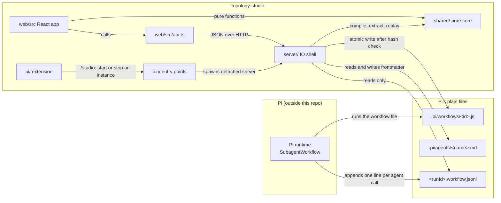
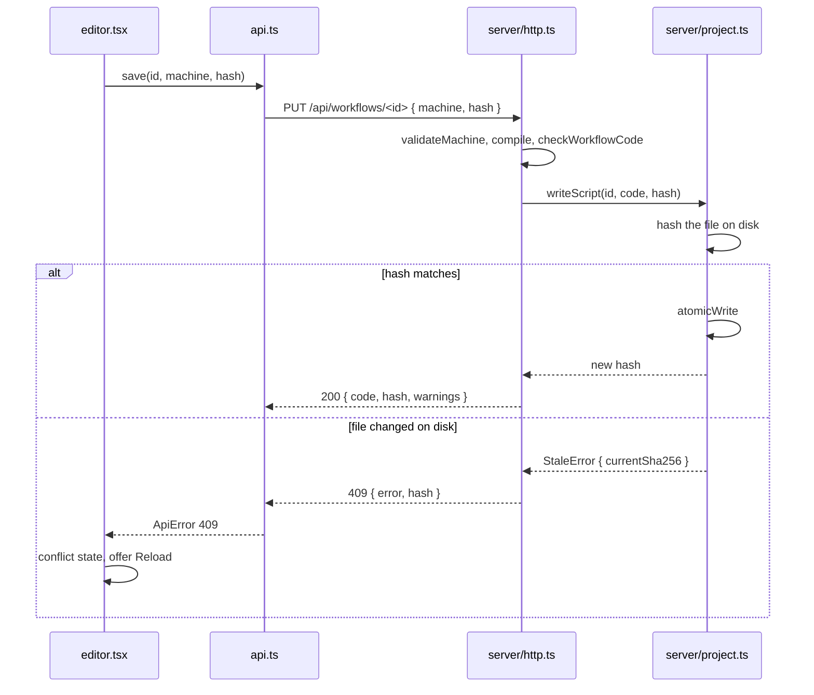
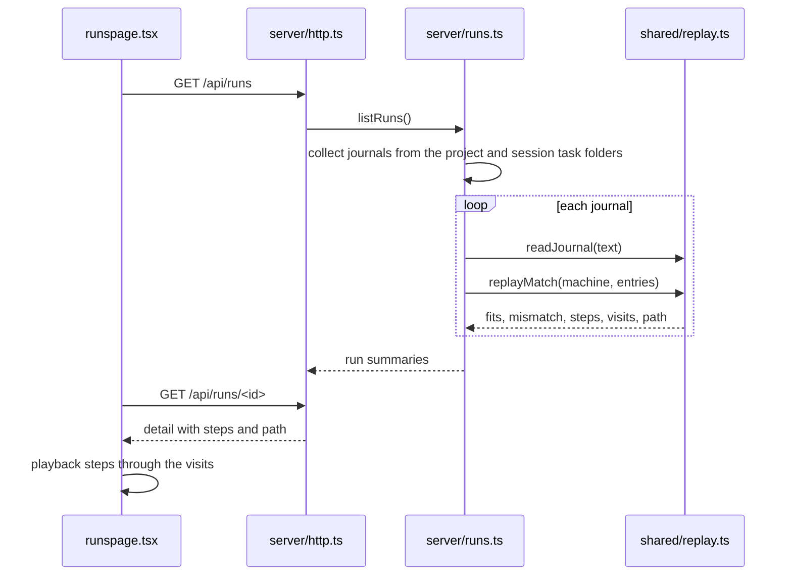

# How topology studio works

Topology studio is a local server and a React app that edit Pi workflow files and replay their runs. Pi runs every workflow. The studio only reads and writes plain files. Terms such as machine, runner, journal and replay are defined in the [domain language](./CONTEXT.md).

The code splits into a pure core in `shared/` and edges that do IO. The edges are: server/, bin/, pi/, scripts/ or web/src/api.ts. That list is written once, in the lint message in `oxlint.config.ts`, and [ADR-0005](./docs/adr/ADR-0005-pure-core-io-at-the-edges.md) explains it.

## Component boundaries

The Pi runtime is the only thing that executes a workflow. The studio writes the file and later reads the journal. Replay looks like a run, but it feeds recorded results to the runner instead of calling agents.

### `shared/`: the functional core

Pure functions that the server, the CLI and the web app all import. No Node built-ins, no Effect and no server code.

| File | What it does |
| --- | --- |
| `machine.ts` | `validateMachine`, `compile` (machine to workflow file) and `extract` (workflow file back to machine). `extract` does not check fields, so callers run `validateMachine` on its result |
| `types.ts` | The machine types: `Machine`, `State`, `Field`, `Transition`, `Branch`, `Kind` and the rest |
| `ops.ts` | Edits on a machine: `addAfter`, `connect`, `renameState`, `setEvent` and the rest. The CLI and the editor share them |
| `refs.ts` | `PLACEHOLDER`, `references` (the refs a state may use) and `unknownRefs` |
| `gate.ts` | Shell-quoting of gate placeholders and the check that a gate can hold them |
| `runner.ts` | The runner as a string. `compile` appends it to every workflow |
| `replay.ts` | `readJournal` and `replayMatch`. Replay runs only the fixed runner, never code from a journal or workflow file |
| `literal.ts` | Turns an acorn AST node into a plain value and rejects anything that is not a pure literal |

### `server/`: the IO shell

| File | What it does |
| --- | --- |
| `http.ts` | Routes under `/api/`, the static web build, the Host check, the token check and the tokenless origin check |
| `services.ts` | `ProjectFs`, the Effect service behind workflow, role and journal file operations. Tests swap it for a fake |
| `edge.ts` | `runEdge`, the only place server code runs an Effect |
| `errors.ts`, `http-errors.ts` | Tagged errors such as `StaleError` and their HTTP status codes |
| `narrow.ts` | Guards for values a `catch` clause leaves open: `isErrno`, `isHinted`, `messageOf` and `isAddressInfo` |
| `project.ts` | `openProject`: one project's workflows, roles, catalog and runs, with every path checked against the project root |
| `runs.ts` | Finds journals and replays each one against the workflow it fits |
| `registry.ts` | All-projects mode: discovers projects, gives each a project id and opens one per request |
| `roles.ts`, `catalog.ts` | Role frontmatter, and the tools and skills a role can pick |
| `check.ts` | `checkWorkflowCode`: size, syntax, no imports, one `export const meta` and a V8 compile of the body |
| `tool-root.ts` | `toolRoot` and `resolveEntry`. Imports only `node:` built-ins, because `bin/studio.ts` loads it before `npm install` |

### `bin/`, `pi/`, `scripts/` and `web/src`

- `bin/studio.ts` is the `agent-topology-studio` command. It hands subcommands to `bin/cli.ts`, or builds the web app when needed and starts the server. `bin/instances.ts` starts, finds and stops detached instances. `bin/dev.ts` runs the API on port 4822 and Vite on 4821. `bin/studio.js` is a small source-only shim that imports `bin/studio.ts`. It does not ship.
- `pi/extension.ts` is the entry Pi loads. `pi/studio.ts` registers `/studio` and is a thin shell over `bin/instances.ts`. `pi/` imports no Pi package.
- `scripts/` holds repository checks: `check-pack.js`, `check-docs.js`, `check-runner-copies.js` and `check-release.js`.
- `web/src` imports pure functions from `shared/` directly. It reaches the server only through `web/src/api.ts`.

## Dependencies

| Package | Where | Why |
| --- | --- | --- |
| `acorn` | `shared/machine.ts`, `server/check.ts` | Parses a workflow file so `extract` can read the machine literal and `check.ts` can report syntax errors |
| `effect` | `server/` only | Services, tagged errors and typed failure paths for file IO |
| `react`, `react-dom` | `web/src` | The UI |
| `vite` | `web/` | Dev server and the build into `web/dist` |
| `@dagrejs/dagre` | `web/src/graph.tsx` | Positions the states. The app draws its own SVG on top |

Only `acorn` and `effect` are runtime dependencies. An installed copy ships the prebuilt `web/dist`.

## Where state lives

The studio keeps no database. Its data is Pi's own files ([ADR-0003](./docs/adr/ADR-0003-pi-plain-files-and-explicit-save.md)):

- workflows: `<project>/.pi/workflows/<id>.js`
- roles: `<project>/.pi/agents/<name>.md`
- project run journals: `<project>/.pi/workflows/<runId>.workflow.jsonl`
- session run journals: `$TMPDIR/pi-subagents-<uid>/<encoded project path>/<session>/tasks/<runId>.workflow.jsonl`, each beside a `<runId>.workflow.js` copy of the script
- skills for the catalog: `<project>/.pi/skills/` and `~/.pi/agent/skills/`

Process bookkeeping and settings:

- instance records: `$XDG_STATE_HOME/topology-studio/`, or `~/.local/state/topology-studio/`. Each instance has a `.json` record, a `.log` and a `.lock`
- all-projects discovery reads `~/.pi/agent/sessions` and `~/.config/topology-studio/projects.json`
- the browser keeps the token, the theme and home-screen timestamps in `localStorage`

## Save with stale refusal

Only Save writes. Saves to one file from one studio run one after another. Other editors are not locked out, which is why the hash check exists.

## Run replay

A session journal is replayed against its sibling `.workflow.js` copy. With no copy, it falls back to the project workflow with the same name. A project journal is replayed against every project machine and keeps the one it fits. `replayMatch` runs the fixed runner with a fake `agent` that answers from the journal. Results are cached by file size, modification time and machine hash.

## All-projects requests

A studio started with `--all` serves each project under `/api/p/<id>/`. The client sends only the project id. The registry maps the id to a root that discovery found and checks that root again before it opens it. A malformed id gets 400 and an unknown id gets 404. See [ADR-0004](./docs/adr/ADR-0004-local-server-security.md).

## `/studio` from Pi

`/studio` calls `startInstance` for the folder Pi works in. It reuses a live instance record, or takes a lock and spawns a detached server, waits for its URL line and writes the record. Then it opens the URL. If the server refuses the folder, for example the studio's own repository, the extension shows the error from the log and opens nothing. The instance outlives the Pi session. `/studio stop` signals its process group. See [ADR-0008](./docs/adr/ADR-0008-pi-studio-command.md).

## Known gaps

The path button puts the full project path in its `title` and `aria-label` (`web/src/parts.tsx`). Screenshots meant for sharing must not show its tooltip.
